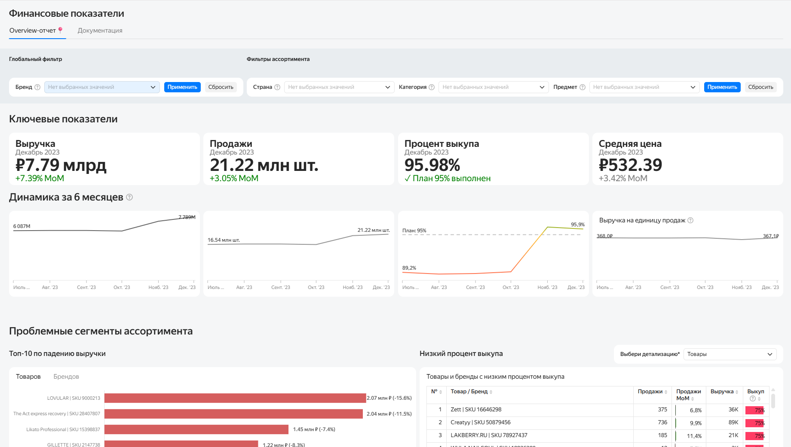
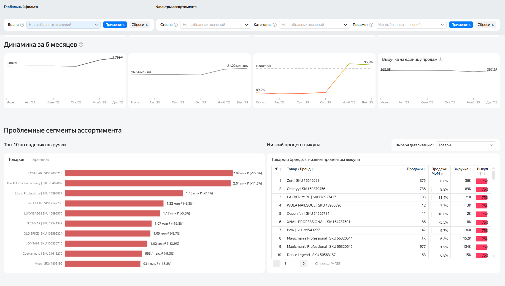

# Анализ финансовых показателей в Yandex DataLens

Обзорный дашборд для анализа финансовых показателей компании,
занимающейся продажей товаров в сфере красоты.

**[Открыть интерактивный дашборд в DataLens](https://datalens.yandex/w64crfqvgpn6f?_share_link=public)**

## О проекте

Проект выполнен в рамках учебного кейса по аналитике данных.

Основной пользователь дашборда — руководитель продуктовой
команды. Отчёт предназначен для ежемесячного анализа
результатов продаж и выявления проблемных сегментов
ассортимента.

Отчётный период — декабрь 2023 года.
Период исторической динамики — июль–декабрь 2023 года.

## Бизнес-задачи

- Контроль роста выручки относительно предыдущего месяца.
- Анализ изменения продаж и средней цены товаров.
- Контроль выполнения плана по проценту выкупа.
- Анализ динамики показателей за шесть месяцев.
- Выявление товаров и брендов с падением выручки.
- Поиск товаров и брендов с высоким уровнем отказов.

## Дашборд

### Ключевые показатели и динамика

### Проблемные сегменты ассортимента

## Источники данных

Исходные данные представлены двумя таблицами:

| Таблица | Детализация | Период |
| --- | --- | --- |
| Product | Отдельные товары (SKU) | Ноябрь–декабрь 2023 |
| Dynamic | Бренды по месяцам | Июль–декабрь 2023 |

Таблицы используются как независимые датасеты.
Прямое соединение по бренду привело бы к дублированию
записей из-за разной детализации данных.

Для совместной фильтрации используется алиас поля «Бренд».

## Что было сделано

- Проведён анализ бизнес-задач.
- Разработан Dashboard Canvas.
- Изучена структура исходных данных.
- Созданы вычисляемые показатели.
- Настроены KPI-карточки и графики динамики.
- Реализовано ранжирование товаров и брендов.
- Настроены параметры, селекторы и связи между датасетами.
- Подготовлена документация дашборда.

## Методика расчёта метрик

| Метрика | Метод расчёта |
| --- | --- |
| Выручка | Сумма выручки |
| Продажи | Сумма продаж с учётом отказов |
| Средняя цена | Среднее арифметическое цен SKU |
| Процент выкупа | Средневзвешенное по количеству продаж |
| MoM | Относительное изменение к предыдущему месяцу |
| Изменение выручки | Выручка декабря минус выручка ноября |
| Выручка на единицу продаж | Выручка / количество продаж |

План роста выручки — не менее 5% MoM.

Плановый процент выкупа — 95%.

## Основные результаты

По итогам декабря 2023 года:

- Выручка составила 7,79 млрд ₽, увеличившись на 7,39%.
- Продажи составили 21,22 млн единиц, рост — 3,05%.
- Средневзвешенный процент выкупа составил 95,98%.
- Средняя цена товара составила 532,39 ₽, рост — 3,42%.

План по росту выручки и проценту выкупа выполнен.

Несмотря на рост общих показателей, отдельные товары
и бренды демонстрируют снижение выручки и высокий уровень
отказов. Для их выявления предусмотрен отдельный блок
дашборда.

## Фильтрация

Фильтр брендов применяется ко всем визуализациям.

Фильтры категории, типа товара и страны производителя
применяются к ключевым показателям и анализу ассортимента.

Шестимесячная динамика доступна только на уровне брендов.

## Ограничения

- История на уровне отдельных товаров доступна
  только за два месяца.
- Процент выкупа рассчитан с весами по продажам
  при допущении, что продажи с учётом отказов
  соответствуют количеству заказанных единиц.
- Низкий процент выкупа не равнозначен низкому спросу.
- Средняя цена SKU и выручка на единицу продаж
  являются разными показателями.
- Данные о себестоимости и маржинальности отсутствуют.

## Использованные инструменты

- Yandex DataLens
- Microsoft Excel
- Dashboard Canvas

## Материалы проекта

- [Dashboard Canvas](docs/dashboard_canvas.pdf)
- [Описание учебного кейса](docs/business_case.pdf)
- [Исходные данные](data/financial_data.xlsx)
